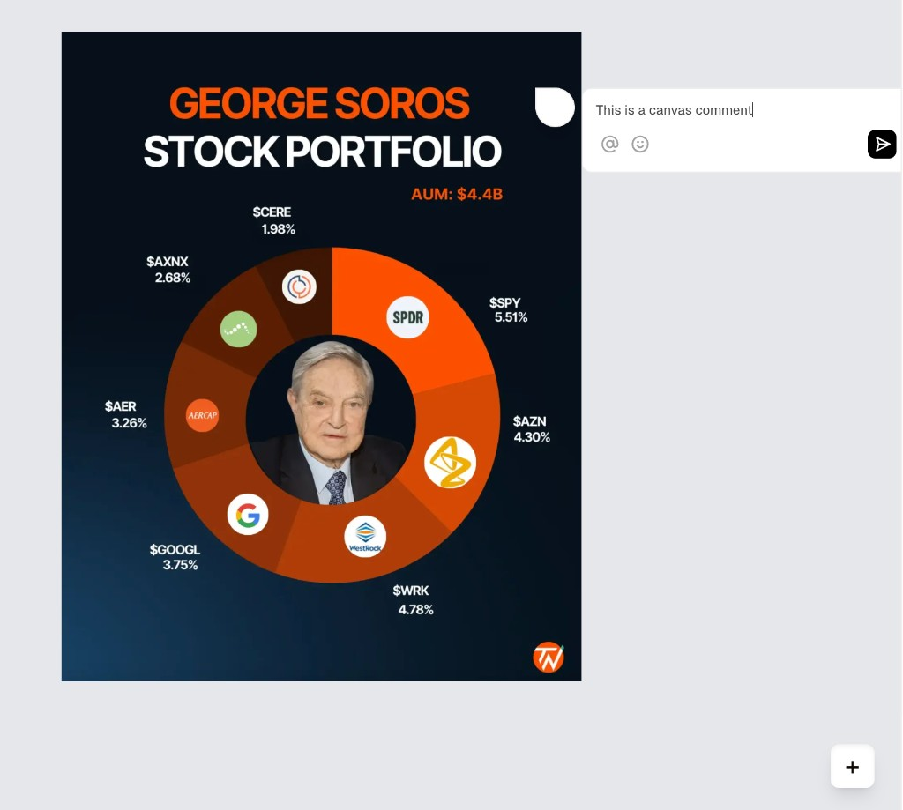
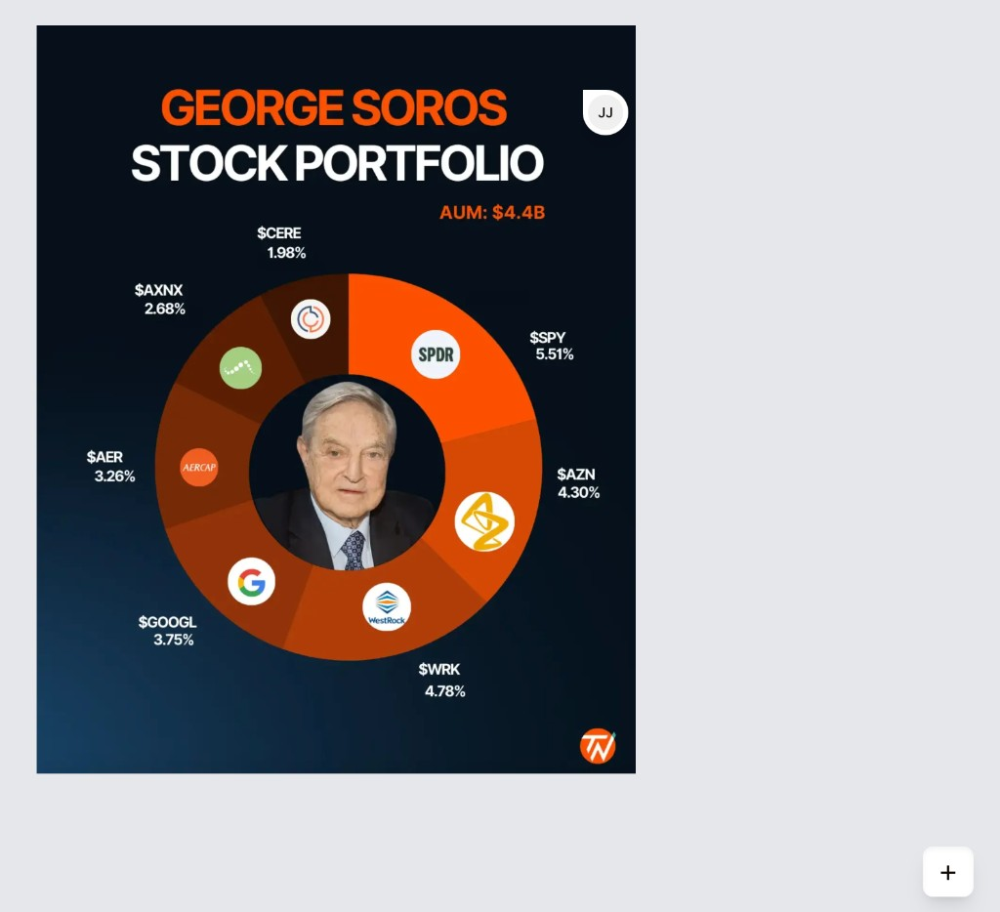
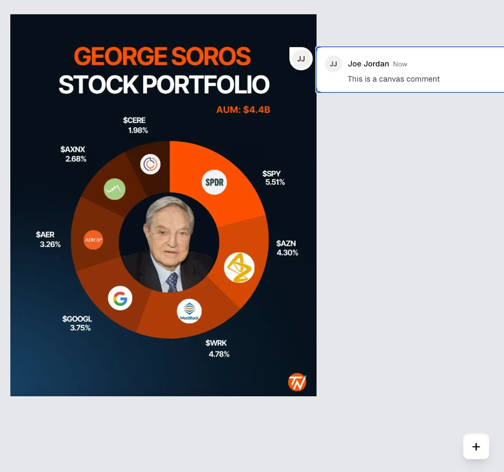

# Adclear Case Study — Product Engineer

## Overview

This case study is designed for candidates applying to work as a Product Engineer at Adclear. It has two parts: a **written product-thinking exercise** and a **practical coding task**.

Adclear is an AI-powered compliance platform that helps financial services teams prepare promotional materials for regulatory review. Our product engineers own features end-to-end — from understanding what to build, to shipping it, to making sure it actually works for users.

This case study tests whether you can take a vague customer request, think critically about it, and turn it into something a team could actually build.

---

## Part A: Product Thinking (Written — No Code Required)

A customer has asked for the following feature:

> "Users should be prevented from submitting for compliance review until all AI findings have been actively reviewed and given a response."

### Product context

Adclear helps teams prepare promotions for review.

A typical workflow looks like this:

* A user creates or edits a promotion
* Adclear AI generates findings on that promotion before human review
* The user can review those findings
* The user then submits the promotion for compliance review

Today, users may be able to submit a promotion for compliance review without explicitly addressing those AI findings.

You've also heard a few bits of stakeholder context:

* One stakeholder says users are skipping obvious AI findings and creating unnecessary review rounds
* Another says they want a clearer audit trail showing that findings were considered
* Another is concerned that a blanket rule could create friction or slow people down

### Your task

Please produce three things in your `RESPONSE.md`:

1. **Questions you would ask**
   What questions would you ask the customer or internal stakeholders to better understand the problem and avoid building the wrong thing?

2. **How you'd gather more information if you couldn't ask directly**
   Assume the customer is unavailable for a week. What data, artifacts, people, or product behaviour would you inspect to reduce ambiguity?

3. **A fleshed-out, developer-ready ticket**
   Write the ticket you would hand to engineering. It should be specific enough that a team could estimate and begin implementation, while clearly calling out any remaining open questions, assumptions, and dependencies.

### Notes

* You do **not** need to design the UI in detail
* Make reasonable assumptions where needed, but label them clearly
* We care more about your thinking and scoping than about finding a single "correct" answer

---

## Part B: React Image Commenting (Coding Task)

Build a React app that lets users add comments to an image on a canvas. This is inspired by design-tool commenting (think Figma) — you'll use [Liveblocks](https://liveblocks.io/docs) as the real-time collaboration layer.

A starter repo is provided: [Liveblocks Canvas Comments Example](https://github.com/liveblocks/liveblocks/tree/main/examples/nextjs-comments-canvas). Clone it, run `npm install && npm run dev`, and build from there.

### Core Features

1. **Image Comments**
   - Allow the user to click anywhere on an image and add a comment anchored to that position
   - Comment threads should flip between left/right alignment based on screen position — if a comment is too close to the right-hand boundary of the image, it should flip inwards
   - Comment position should scale gracefully with zoom level, ensuring the original anchor position is maintained

2. **Canvas Interactions**
   - Draggable image (pan)
   - Zoom in/out controls
   - Comments maintain position relative to the image during pan and zoom

### Optional Features

- Responsive design for different screen sizes
- Comment editing functionality

### Examples

Use these as a design reference, but prioritise functionality over pixel-perfect replication.

### UI/UX Guidelines

- Feel free to iterate on the design or incorporate additional libraries if you believe they enhance usability
- You can use any icon library — no need to match specific icons
- These are loose guidelines; improvise as you see fit

### Evaluation Criteria

| Area | What we're looking for |
|------|----------------------|
| **Functionality** | Does the app work as expected? |
| **Code Quality** | Is the code organised, clean, maintainable/testable, and following best practices? |
| **State Management** | How efficiently is state managed across components? |
| **Error Handling** | How does the app behave in unexpected scenarios? |
| **UI/UX** | Thoughtfulness in user experience and design, even with freedom |

---

## Time Expectation

- **Part A** (Written): ~60–90 minutes
- **Part B** (Coding): ~4 hours maximum

There is no hard deadline — take the time you need to do it well. Focus on implementing as much as possible within the time frame. Don't stress about absolute completion.

---

## Submission

1. Clone this repository
2. Write your Part A response in `RESPONSE.md`
3. Build Part B in the repo (ensure the README provides setup instructions)
4. Commit your changes in a new branch with clear, descriptive messages
5. Push to your own GitHub repository
6. Email us the link to your repository

Good luck!
